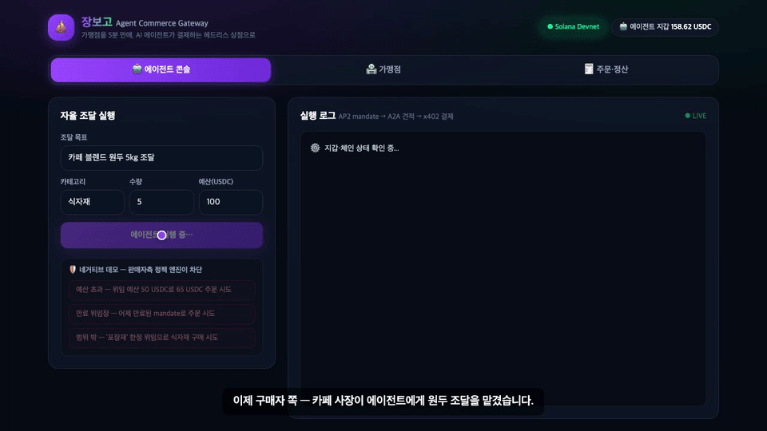
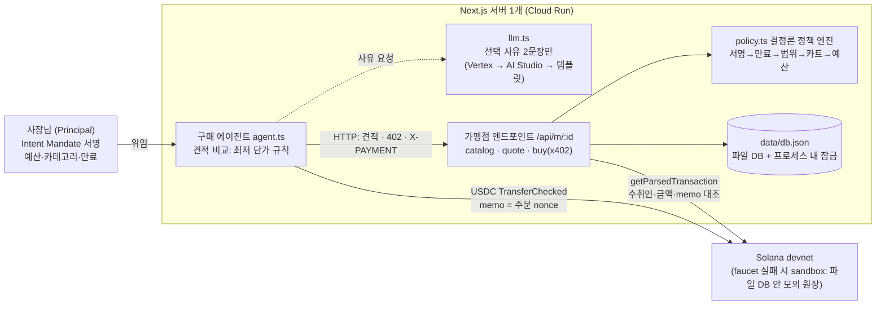
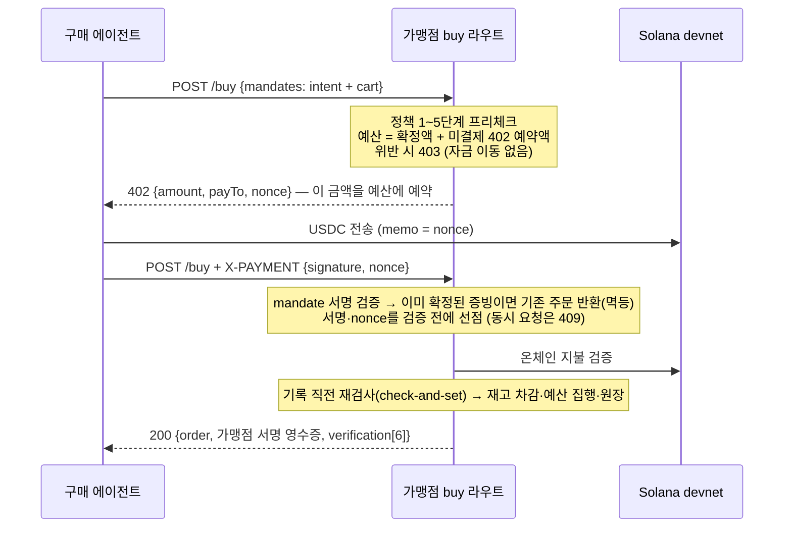

# 장보고 (JangBogo) — Agent Commerce Gateway

> AI 구매 에이전트가 가맹점에 결제하려 할 때, **가맹점 쪽 결정론 정책 엔진**이 위임장(예산·범위·만료)과 온체인 지불을 검증한 뒤에만 주문을 확정하는 게이트웨이. Next.js + Solana devnet으로 구현한 해커톤 제출작이다.

[](https://github.com/jang961111-hash/jangbogo/actions/workflows/ci.yml) 

**데모**: [라이브](https://jangbogo-748897460867.asia-northeast3.run.app) (Cloud Run, **Solana devnet 전용**, 최소 인스턴스 0이라 첫 요청은 콜드스타트로 느릴 수 있다) · [데모 영상](https://youtu.be/ALdVyGhXPT8) · [온체인 증빙 tx](https://explorer.solana.com/tx/5yqKUxtroZiKAFfavT6sLZwgb9BuFxdP881vgtTKBBPPbrjezxoGyMFL4wZyzYYRDvBzxBA7qZTJp21hTNSVFPEq?cluster=devnet)
**맥락**: Google x Solana AI Agentic Hackathon 트랙 B(Autonomous On-chain Settlement) 제출작 · 팀 "사공이" 2인 · 2026-08-03 23:56 제출(마감 23:59)
**스택**: TypeScript · Next.js 15 (App Router) · React 19 · Tailwind CSS 4 · @solana/web3.js · @solana/spl-token · tweetnacl(ed25519) · Gemini(REST 직접 호출) · vitest · Cloud Run · GitHub Actions



## 먼저 읽기 — 이 레포가 무엇이고 무엇이 아닌가

- **AI가 하는 일은 작다.** 상품 선택은 "조건을 만족하는 견적 중 최저 단가" 규칙(`src/lib/agent.ts`)이고, 결제 승인은 결정론 정책 엔진(`src/lib/policy.ts`)이 한다. Gemini는 **선택 사유 2문장**만 쓴다(`src/lib/llm.ts`). 키가 없거나 호출이 실패하면 템플릿 문장으로 폴백한다. 프롬프트 인젝션으로 결제 한도를 뚫을 수 없게 LLM을 신뢰 경계 밖에 둔 것이 설계 의도다.
- **Solana 결제는 실제다.** devnet에 자체 발행한 mock USDC(SPL 토큰)를 `TransferChecked` + Memo(주문 nonce)로 보내고, 서버가 `getParsedTransaction`으로 수취인·금액·memo를 대조한다. 위 증빙 tx는 2026-09-28 devnet RPC 재조회에서도 `finalized`다.
- **AP2·x402·A2A는 SDK 없이 JSON 구조만 빌린 자체 축약 구현이다.** AP2는 ed25519 서명 JSON 두 장(Intent/Cart Mandate, `ap2-lite/1`)이고 SD-JWT 같은 실제 스펙 요소는 없다. x402는 402 응답 본문과 `X-PAYMENT` 헤더 모양만 따르고 facilitator가 없다. A2A는 견적 메시지의 `role`/`parts` 모양만 따른다.
- **구현은 Claude Code 세션 하나로 약 4시간(2026-08-03 20:28~00:25 KST)에 했다.** 코드 대부분이 첫 커밋 `2c8cd5e`(+7,274줄) 하나에 들어 있다. 당시 커밋 6개는 23:18~00:18에 찍혔고, 그중 3개는 제출 후, 2개는 마감 후다(전부 README·문서 수정). 이력은 고치지 않았다.
- **해커톤 제출본에는 결제 경합 결함이 있었다.** 2026-09 사후 점검에서 재현했고 [PR #1](https://github.com/jang961111-hash/jangbogo/pull/1)에서 고쳤다(아래 핵심 수치, [트러블슈팅](docs/TROUBLESHOOTING.md)). 이 README는 PR #1 위에 쌓은 문서 PR이다.

## 핵심 수치

사후 재측정은 전부 **2026-09-28**, Apple Silicon · macOS · Node v26.5.1 · `CHAIN_MODE=sandbox`(외부 네트워크 호출 0건)에서 쟀다. 측정 커밋을 함께 적는다.

| 지표 | 값 | 측정 방법 (측정일 · 커밋) |
|---|---|---|
| 같은 결제 증빙 동시 전송 시 주문 수 | 1회 지불로 주문 **최대 10건 → 1건** (재고 50kg → 5kg 차감, 원장 10줄 → 1줄) | 검증 지연 650ms 주입, 동시 K=1·2·5·10 × 5회. 전 `345fdea` / 후 `5aa2514`, `763ff2b`에서 재확인 0/20 (2026-09-28) |
| 예산 100 USDC 위임장의 최대 확정액 | **327.59 → 65.52 USDC** (예산 초과 15/15 → 0/15) | 같은 조건, K=2·3·5 × 5회 (2026-09-28, 커밋 같음) |
| 지불 후 거절(돈만 이동) | **262.07 → 0 USDC** | 같은 위임장으로 402를 여러 번 받아 지불, 지연 0ms (2026-09-28, 전 `345fdea` / 후 `5aa2514`) |
| 테스트 | vitest **28/28** (단위 11 + 결제 무결성 17) · 서버 통합 **24/24 ×3회** | `npm test` · sandbox 서버 기동 후 `npm run test:integration` (2026-09-28, `763ff2b`, CI run 36393689598) |
| 테스트 커버리지 (`src/**` 라인) | **10.2% → 39.2%** (buy 라우트 0% → 98.9%) | `npx vitest run --coverage --coverage.include='src/**'`, `@vitest/coverage-v8@3.2.7` 임시 설치 (2026-09-28, 전 `345fdea` / 후 `763ff2b`) |
| 풀사이클 (앱 자체 오버헤드) | p50 **0.13s** / p95 **0.27s**, n=30, 30/30 성공 | sandbox 체인 + LLM 없음(템플릿 사유)에서 `/api/agent/run` 순차 30회, 클라이언트 벽시계 (2026-09-28, `345fdea`). 체인·LLM 대기가 빠진 값이다 |
| 풀사이클 (devnet + Gemini, 당시 기록) | **4.9 ~ 11.1초** (6건: 4.9·5.3·6.3·9.9·10.5·11.1) | 2026-08-03 빌드 세션 로그의 "자율 조달 완료 (Ns)" 값. 로컬/라이브, Gemini/템플릿 폴백이 섞여 있다. **재측정 못 함**(devnet faucet 429, Gemini 선불 크레딧 소진) |
| Lighthouse (`/`, 모바일) | 성능 100 · 접근성 95 · 권장사항 96 · SEO 100 (3회 중앙값) | `npx lighthouse@12 http://localhost:3402` ×3 (2026-09-28, `345fdea`) |

전후 비교의 원자료와 한계(devnet 조건 미측정, 단일 프로세스 기준)는 [docs/TROUBLESHOOTING.md](docs/TROUBLESHOOTING.md)에 있다. 지연 주입은 sandbox 전용 훅 `SBX_VERIFY_DELAY_MS`로 하고, 650ms는 같은 날 잰 devnet `getTransaction` 조회 p50(0.66s, n=5)에 맞춘 값이다. 동시 전송 수치를 낸 측정 스크립트는 레포 밖 측정 하네스이고, 같은 조건은 `tests/payment-integrity.test.ts`가 레포 안에서 검사한다.

## 내가 한 일

팀은 2인으로 등록했지만 **이 레포의 커밋은 전부 내 계정**이다(해커톤 당시 6개, 이후 PR #1 커밋까지). 두 번째 팀원(김지원 님)은 레포 협업자로 초대했고 커밋 2개(`a09adc9`, `345fdea`)에 `Co-Authored-By`로 표기돼 있다. 팀원 기여 범위는 확인이 필요하다. 해커톤 당시 README의 역할 표는 제출폼 초안에서 옮긴 것이라 이번에 뺐다.

- **해커톤 당일 (2026-08-03)**: 리서치 문서(`해커톤_종합딥리서치.docx`)를 주고 Claude Code 세션에 기획→설계→개발→테스트→배포→QA 루프를 지시했다. 기획안 선정과 코드 작성은 그 세션이 했다. 내가 직접 한 일은 Solana faucet·Gemini API 키·GCP(`gcloud`) 인증과 계정 작업, 화면·시각화 개선 요구, 제출폼 작성·제출과 영상 업로드, 과장 표현을 걷어내는 README "정직 고지" 보강 지시다.
- **사후 점검 (2026-09-28)**: 재측정으로 결제 경합(T8)과 지불 후 거절(T12)을 재현했다. 재현 테스트를 먼저 올리고(6 failed) 수정 커밋을 쌓은 뒤, 작성과 분리한 보안 리뷰에서 **수정이 만든 퇴행**을 잡아 다시 고쳤다. CI(GitHub Actions)를 처음 붙였다. → [PR #1](https://github.com/jang961111-hash/jangbogo/pull/1) (머지 전)
- **이 문서 PR**: README를 코드 기준으로 다시 썼다. 기존 README·설계 문서와 코드의 불일치 15건을 정정했다.

## 아키텍처



에이전트와 가맹점이 같은 서버에 있지만, 에이전트는 가맹점을 **HTTP로** 호출한다(Cloud Run에서는 `SELF_URL` 루프백). 가맹점 엔드포인트가 외부 에이전트에게도 같은 방식으로 열려 있다는 것을 보이기 위한 구조다.

### 결제 흐름 (PR #1 반영)



지불은 확인됐는데 그사이 재고 소진·402 만료로 확정할 수 없으면 조용히 거절하지 않고 `unconfirmedPayments`에 "지불됨·미확정"으로 기록하고 `409 PAYMENT_RECEIVED_UNCONFIRMED`를 돌려준다. 환불은 자동화하지 않았다(가맹점 수동 처리).

### 판매자측 검증 6단계

| # | 단계 | 거절 코드 |
|---|---|---|
| 1 | 위임장·카트 ed25519 서명, intentHash 일치 | `MANDATE_INTENT_SIG_INVALID` · `MANDATE_CART_SIG_INVALID` · `MANDATE_HASH_MISMATCH` |
| 2 | 위임 유효기간 | `MANDATE_EXPIRED` |
| 3 | 위임 범위(카테고리) | `MANDATE_SCOPE_VIOLATION` |
| 4 | 카트 정합성(품목·단가·재고·합계) | `CART_ITEM_UNKNOWN` · `CART_PRICE_MISMATCH` · `CART_STOCK_INSUFFICIENT` · `CART_TOTAL_MISMATCH` |
| 5 | 누적 예산(확정액 + 미결제 402 예약액) | `MANDATE_BUDGET_EXCEEDED` |
| 6 | 온체인 지불(수취인·금액·memo=nonce), 리플레이, 402와 품목 일치 | `PAYMENT_*` |

1~5단계는 `policy.ts`, 6단계는 `src/app/api/m/[id]/buy/route.ts`에 있다. 1~5단계는 402를 발급하기 **전에** 검사하므로 위반하면 돈이 움직이지 않는다.

## 기술적 결정

| 결정 | 대안 | 선택 이유 | 대가(trade-off) |
|---|---|---|---|
| 결제 승인·한도 집행은 결정론 코드, LLM은 사유 서술만 | LLM이 견적 선택·승인 판단 | 프롬프트 인젝션을 완전히 막을 방법이 없으므로 돈이 걸린 판단에서 LLM을 뺀다 | "AI 에이전트"라고 부르기에 AI의 몫이 작다 |
| 판매자(가맹점) 측 검증 | 구매자 측 한도 지갑 | 가맹점이 "이 에이전트를 믿어도 되나"를 스스로 판단할 수 있어야 자율 결제를 받는다 | 구매자 측 통제는 다루지 않는다 |
| 주문마다 새 nonce를 온체인 Memo에 기록 | tx 서명만 대조 | 주문과 결제를 1:1로 묶어, 지난 결제로 새 주문을 확정하지 못하게 한다 | 에이전트가 memo를 붙여 전송해야 한다 |
| 금액은 정수 micro-USDC | 부동소수 USDC | 반올림 오차 없이 예산·원장을 합산한다 | 표시할 때마다 변환한다 |
| 402 발급 시 예산 예약 (PR #1) | 확정 시점에만 예산 검사 | 확정 시점 검사는 **지불 후 거절**을 만든다. 넘을 402는 애초에 발급하지 않는다 | 미결제 402가 만료(5분)될 때까지 예산을 잡고 있다 |
| 결제 증빙 선점은 프로세스 메모리 Set (PR #1) | DB 유니크 제약·트랜잭션 | Node 단일 스레드에서 `await` 없는 검사→등록은 원자적이다. 파일 DB에는 트랜잭션이 없다 | **인스턴스 1개일 때만 맞다.** 다중 인스턴스에서는 뚫린다 |
| 재고는 예약하지 않는다 (PR #1) | 402 발급 시 재고도 예약 | 402 남발로 재고를 잠그는 공격을 피한다 | 두 402가 같은 재고를 다투면 한쪽은 "지불됨·미확정"이 된다 |
| 상태는 파일 JSON DB | Firestore 등 관리형 DB | 해커톤 4시간 안에 설치 없이 돌아가게 | 다중 인스턴스 불가, 요청마다 파일 전체를 읽고 쓴다 |

## 트러블슈팅 (요약 → 상세는 [docs/TROUBLESHOOTING.md](docs/TROUBLESHOOTING.md))

- **같은 결제 증빙을 동시에 보내면 주문 10건** → 리플레이 검사와 기록 사이에 온체인 검증 `await`가 끼어 있음 → 검증 전 선점 + 기록 직전 재검사 (주문 최대 10 → 1)
- **예산 100 USDC로 327.59 USDC 확정, 순차 요청은 지불 후 거절** → 402 발급 때 미결제 금액을 예산에서 빼지 않음 → 402 발급 시 예산 예약 (327.59 → 65.52, 지불 후 거절 262.07 → 0)
- **보안 리뷰가 잡은 수정의 퇴행** → "지불 확인되면 미확정으로 기록" 경로를 위조 cart로 먼저 태우면 정당한 지불이 영구 409 → 기록 대상을 상태 의존 실패로 한정, 서명 검증을 맨 앞으로. 이 과정에서 **402와 품목만 바꾼 cart가 확정되는** 원래 구멍도 찾아 막음
- **파일 DB 쓰기 중단 시 리플레이 방어 소실** → 제자리 덮어쓰기 + 파싱 실패 시 빈 DB → 임시 파일 후 rename, 파싱 실패는 fail-closed
- **"원두를 시켰더니 베이글"** (해커톤 당일) → 키워드 무매칭 시 전체 상품 반환 → 무매칭이면 견적 0건. 상품명 일반어 일치("카페 베이글")는 **아직 뚫린다**

## 실행 방법

사전 요구: Node 22 (CI 기준, 로컬 측정은 Node 26에서도 동작).

```bash
git clone https://github.com/jang961111-hash/jangbogo.git
cd jangbogo
npm ci
npm run dev          # http://localhost:3402
```

첫 접속 때 `/api/setup`이 키 생성 → devnet airdrop → mock USDC 발행 → 데모 가맹점 시딩을 한다. faucet이 막히면(429) **sandbox 모드**로 떨어진다. sandbox는 `chain.ts`의 인터페이스는 같지만 전송·검증을 파일 DB 안의 모의 원장으로 처리하는 **다른 구현**이다(UI에 배지 표시). payer 지갑에 devnet SOL을 넣으면 devnet으로 돌아간다. 키와 상태는 `data/db.json`(gitignore)에 평문으로 저장된다. devnet 데모용이다.

외부 네트워크 없이(CI와 같은 조건) 테스트까지 돌리려면:

```bash
npx tsc --noEmit                    # 타입 검사
npm test                            # vitest 28개 (단위 11 + 결제 무결성 17), 서버 불필요

npm run build
CHAIN_MODE=sandbox SBX_VERIFY_DELAY_MS=50 npx next start -p 3402 &
npm run test:integration            # 서버 통합 24개 (풀사이클 + 공격 시나리오 + 동시성)
```

- `SBX_VERIFY_DELAY_MS`는 sandbox 모드에서만 동작하는 검증 지연 훅이다. 동시성 경합을 재현할 때 쓴다.
- `npm start`는 `output: "standalone"` 설정 때문에 경고를 내지만 동작한다. Docker 이미지는 `node server.js`로 실행한다.
- 선택 환경변수(`.env.local`): `GEMINI_API_KEY`(없으면 템플릿 사유), `GEMINI_MODEL`(기본 `gemini-flash-latest`), `VERTEX_PROJECT`(Cloud Run용), `SOLANA_RPC_URL`.

## API

| Method | Path | 설명 |
|---|---|---|
| `GET` | `/api/state` | 대시보드 상태 스냅샷 |
| `POST` | `/api/setup` | 부트스트랩(멱등): 키·mint·지갑 충전, devnet 실패 시 sandbox |
| `POST` | `/api/agent/run` | 구매 에이전트 실행, SSE 로그 스트림. Body `{goal, category, qty, budgetUsdc, maxUnitPriceUsdc, scenario}` |
| `GET` | `/api/merchants` | 가맹점 목록 |
| `POST` | `/api/merchants` | 가맹점 온보딩(엔드포인트 즉시 발급) |
| `GET` | `/api/m/{id}/catalog` | 기계용 카탈로그 |
| `POST` | `/api/m/{id}/quote` | 견적 교환(A2A 메시지 모양) |
| `POST` | `/api/m/{id}/buy` | x402 흐름: 1차 402 / 2차 `X-PAYMENT` → 검증 → 주문 + 가맹점 서명 영수증 |

인증과 rate limit은 없다(아래 한계). 상세: [docs/03-API-SPEC.md](docs/03-API-SPEC.md)

## 알려진 한계

- **다중 인스턴스 불가**: 결제 증빙 선점 잠금과 파일 DB가 프로세스 하나 기준이다. 인스턴스가 둘 이상이면 경합 방어가 뚫린다. 공유 DB의 유니크 제약과 트랜잭션이 필요하다. 라이브는 최대 인스턴스 1로 두었다.
- **가맹점 인증 없음**: 누구나 가맹점을 등록할 수 있고, 견적 매칭은 목표 문장 토큰 하나만 상품명에 들어 있어도 통과한다. "카페 베이글"이라는 가맹점을 등록하면 기본 목표 "카페 블렌드 원두 5kg 조달"에 베이글이 낙찰된다(2026-09-28 로컬 재현).
- **환불 자동화 없음**: "지불됨·미확정"은 기록만 하고 환불은 수동이다.
- **의존성 취약점**: `npm audit --omit=dev` 13건(critical 1건은 `next`), 2026-09-28 기준 미조치.
- **devnet 조건 재측정 못 함**: faucet 429로 PR #1 전후 비교는 sandbox + 지연 주입으로만 했다. devnet 경로도 같은 잠금 뒤에서 검증하므로 막힌다는 것은 코드 구조로 추론한 것이고 실측이 아니다.
- **Docker 새 클론 빌드 미확인**: `Dockerfile`이 gitignore된 `data/`를 복사한다. 새 클론에서 `docker build`가 실패할 것으로 보이지만 확인하지 못했다.
- 원화 정산은 고정 환율(1 USDC = 1,450 KRW) 시뮬레이션이다. pay.sh 연동 코드는 없다.

## 회고

- 돈이 걸린 판단을 LLM 밖에 둔 경계 설계는 지금 봐도 맞았다. 그러나 "리플레이 차단"을 강점으로 내세우면서 **동시 요청을 한 번도 시험하지 않았다.** 순차 테스트 20개가 전부 통과해 안심했다.
- 사후 수정에서는 내 수정이 새 공격면을 열었다. 작성과 리뷰를 다른 에이전트로 나눈 덕에 머지 전에 잡혔다.
- 다시 만든다면 첫날부터 공유 DB의 유니크 제약으로 멱등성을 걸고, 동시성 테스트를 테스트 계획에 넣는다. → [docs/RETROSPECTIVE.md](docs/RETROSPECTIVE.md)

## 문서

| 문서 | 내용 |
|---|---|
| [docs/TROUBLESHOOTING.md](docs/TROUBLESHOOTING.md) | 트러블슈팅 6건 상세, 전후 수치 |
| [docs/RETROSPECTIVE.md](docs/RETROSPECTIVE.md) | 회고 (KPT, 다시 만든다면, 사후 보완 내역) |
| [docs/00-CONTEXT.md](docs/00-CONTEXT.md) ~ [docs/05-DEPLOY.md](docs/05-DEPLOY.md) | 해커톤 당시 기획·설계·API·테스트·배포 문서 (2026-09-28 코드 기준으로 틀린 곳 정정) |
| [docs/06-QA-REPORT.md](docs/06-QA-REPORT.md) | 2026-08-03 당시 QA 기록 (수정하지 않고 보존) |
| [submission/](submission/) | 제출 당시 소개서 PDF·발표 자료 |

## 라이선스

[MIT](LICENSE)
